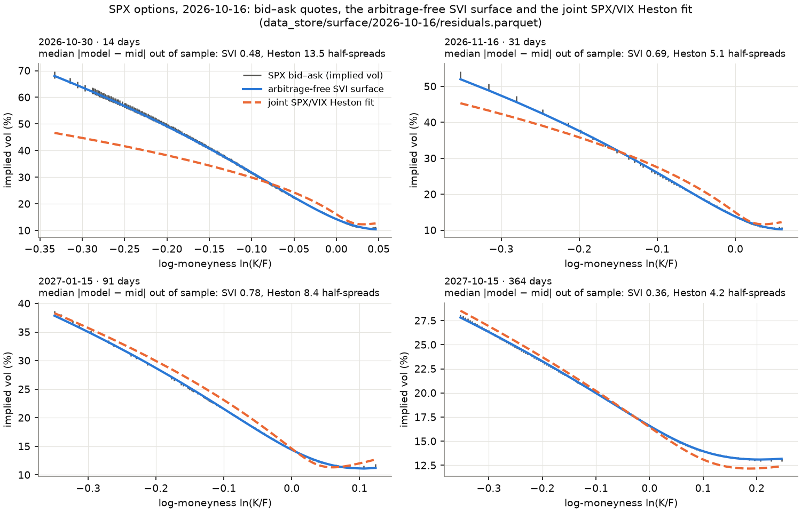
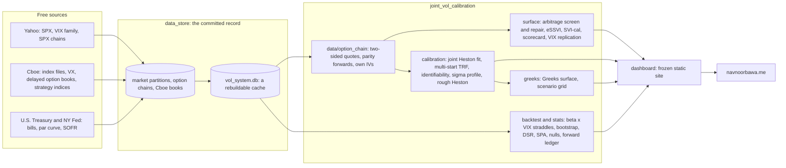

# Joint SPX/VIX Calibration System

[](https://github.com/navnoorthapar/vol-system-dashboard/actions/workflows/tests.yml)
[](https://github.com/navnoorthapar/vol-system-dashboard/actions/workflows/daily_refresh.yml)
[](docs/install.md)
[](LICENSE)
[](CITATION.cff)

An end-of-day research system that fits one Heston model jointly to the SPX option smile and the four Cboe VIX indices
(VIX options are a research leg, not in the fit), scores every model against bid–ask quotes it was not fitted to, and
reports a mark-to-model straddle backtest with its statistical inference. The backtest result is negative and is
published as such.

**Three results** (headline session 2026-10-16; ranges over the five sessions with a stored chain and an accepted fit,
2026-03-24 to 2026-10-16):

1. **Interpolation floor.** A certified arbitrage-free, calendar-ordered SVI surface prices held-out strikes to a
   median **0.55 half-spreads** of the quoted bid–ask (80.0% inside it). Range over the five sessions: **0.45–1.98**
   half-spreads (a range, not a confidence interval; held-out strikes lie between fitted ones).
2. **Joint SPX/VIX calibration, out of sample.** Heston, fitted to 53 SPX anchors and the four Cboe VIX indices, misses
   the other 2,860 quotes by **2.96 vol pts** RMSE with σ on its 2.0 cap. Rough Heston on the same quotes: **1.09**.
   Range: Heston 1.28–2.96, rough Heston 1.09–1.83; rough is lower on 3 of 5 sessions and returns H = ½ (Heston) on 2.
3. **Backtest, 2018-01-02 → 2025-03-24, straddles marked at β·VIX.** Portfolio Sharpe **−0.99**, 95% CI **−1.81 to
   −0.30** (stationary bootstrap). No published series beats cash (Hansen SPA p 0.65); S3's entry timing has p 0.078
   against 3,550 exposure-matched circular shifts (Holm over six series 0.47).



**Limitations.** Yahoo end-of-day chains carry no quote time, so part of every spread miss can be staleness. Cboe's
timestamped books are stored from 2026-10-20, and the forward ledger at executable prices has no entry yet. Every
backtest P&L is Black–Scholes at β·VIX: no option prices exist inside the window. Heston's vol-of-vol sits on its cap
in 2 of 5 fits. One developer, so no independent validation.

**Links.** [Live dashboard](https://navnoorbawa.me) · [Docs](docs/README.md) ·
[Validation pack](docs/model_validation/README.md) · [Reproduce](docs/reproduce.md) ·
[Corrections C16–C23](docs/corrections.md) · [What free resources reach](docs/free_resources_scorecard.md) ·
[Install](docs/install.md) · [Cite](CITATION.cff)

---

## Architecture



`scripts/cloud_refresh.py` is the only writer in the daily job, which is built to run every U.S. session: market data
and rule labels after the close; in the book slot the Cboe book capture, the calibration, a forward-ledger entry for
every session with a live captured book (whatever the fit does) and, after an accepted fit, its surface report,
diagnostics, Greeks and scenario grid. Each book run also rebuilds derived artifacts an earlier run failed to build.
The captures leave the runner first, as a workflow artifact, and are committed in their own commit behind integrity
checks only; data tests gate the data commit, artifact tests the derived artifacts, presentation tests only the
deploy. The dashboard is a read-only renderer, and `dashboard/freeze_site.py` refuses to publish a page that reports a
loader error. What is stored so far was not all written by the scheduled job: the 2026-10-16 fit and the first Cboe
capture (2026-10-20) were made by the job's code from development runs, and the git history says which commit wrote
each file.

## Quickstart

```bash
git clone https://github.com/navnoorthapar/vol-system-dashboard && cd vol-system-dashboard
python3.11 -m venv .venv && . .venv/bin/activate
make install        # Linux x86_64: the exact lock CI uses; elsewhere `make install-any` (docs/install.md)
make test-fast      # core numerics and property tests, about a minute; `make test` runs the full suite
make demo           # the dashboard on 127.0.0.1, read-only, from the committed artifacts
make reproduce      # rebuild the committed artifacts from the captures and diff them (docs/reproduce.md)
```

[docs/install.md](docs/install.md) lists the platforms the dependency ranges resolve on (an Intel Mac does not; use
the container there). The repository ships `data_store/`, so nothing above needs the network.

## Calibration

The headline fit is the newest model_version 2 fit that passes the quality gate (≥ 4 SPX expiries, ≥ 30 options, a
put wing in ≥ 3 expiries, ≥ 3 VIX tenors, a snapshot dated to the spot session), never the lowest-RMSE one:
[docs/corrections.md](docs/corrections.md#why-the-headline-fit-is-chosen-on-data-sufficiency-not-rmse-c20-c22) says
why. Every committed SPX chain is fitted by the same calibrator (`data_store/calibrations/joint_cal_<session>.pkl`):

| Session | κ | θ | σ | ρ | v₀ | SPX in-sample / OOS (vp) | VIX index (pts) | VX futures, OOS (pts) |
|---|---|---|---|---|---|---|---|---|
| 2026-03-24 | 6.142 | 0.0653 | 2.000* | −0.823 | 0.0732 | 1.207 / 1.980 | 0.888 | 2.66 |
| 2026-03-27 | 4.290 | 0.0733 | 1.834 | −0.785 | 0.0928 | 1.365 / 1.538 | 0.852 | 3.18 |
| 2026-05-29 | 5.233 | 0.0595 | 1.707 | −0.656 | 0.0130 | 0.911 / 1.285 | 0.523 | 2.56 |
| 2026-06-18 | 4.999 | 0.0614 | 1.592 | −0.697 | 0.0173 | 0.855 / 1.833 | 0.510 | 1.85 |
| **2026-10-16** | **4.992** | **0.0499** | **2.000\*** | **−0.753** | **0.0344** | **1.336 / 2.955** | **0.823** | n/a† |

\* σ on its box ceiling, reported by the fit as an active constraint; Feller is violated in all five and imposed in none.
† The Cboe VX history in the database ends 2026-10-09, before this session.

What C23 measured about these fits (`data_store/calibrations/diagnostics/`, the Calibration page):

- **The σ box.** Refitting 2026-10-16 with σ ≤ 10 and κ ≤ 60 gives σ 6.90, κ 27.4, a loss 27.7% lower and an
  out-of-sample RMSE of 1.19 instead of 2.96 vol pts; on 2026-03-24 the box costs 2.1% of the loss. At the boxed optima
  the model's VVIX is 160–211 against a market ^VVIX of 86–133.
- **Identification.** cond(JᵀJ) of the relative-sensitivity Jacobian is 150–293; κ's Gauss–Newton standard error is
  12–19% of κ (a curvature scale, not a sampling distribution). Multi-start trust-region least squares with an analytic
  Jacobian finds one basin on every session and reaches the stored differential-evolution optima to a relative loss
  of at most 3.6e-7 (slightly below them) in 1.7–2.1 s, against 19.8–28.3 s for serial DE (4 vCPU). From the next fit the daily job uses it,
  warm-started from the previous accepted fit; DE stays as an optional global check.
- **Rough Heston** (lifted, 20 factors, H ∈ [0.02, ½], same anchors, VIX leg and quotes) lowers the out-of-sample
  error on 3 of 5 sessions and returns H = ½ (Heston) on the other two. H is weakly identified and sits on its 0.02
  floor on 2026-10-16, so no roughness estimate is read from these fits (compare arXiv:2401.03345).

| Session | Heston OOS (vp) | Rough Heston OOS (vp) | H |
|---|---|---|---|
| 2026-03-24 | 1.98 | 1.42 | 0.28 |
| 2026-03-27 | 1.54 | 1.41 | 0.36 |
| 2026-05-29 | 1.28 | 1.28 | 0.50 |
| 2026-06-18 | 1.83 | 1.83 | 0.50 |
| 2026-10-16 | 2.96 | 1.09 | 0.02 |

On the 1,473–3,695 quotes per session that no model was fitted to (`data_store/surface/<session>/scorecard.json`,
`metrics.common_out_of_sample`), Heston's median |model − mid| is 4.4–15.6 half-spreads against 0.45–1.98 for the
certified arbitrage-free SVI surface (Durrleman g ≥ 0 and calendar order checked on a 1e-4 grid over ln K/F ∈ [−3, 2],
a 1/k grid to |k| = 2,000–3,000 and the |k| → ∞ limits). The VIX computed from each session's own SPX chain with
Cboe's rules is within 0.09–0.78 index points of the official close; most of that gap is not explained by the stored
chain ([validation pack](docs/model_validation/README.md#m14-quote-grade-surface), M14).

## Backtest (a proxy study, mark-to-model)

Delta-hedged 30-day ATM straddles, one $1M sleeve per signal, 2018-01-02 → 2025-03-24 (1,816 sessions); portfolio =
(S1C + S3 + S4) / 3. Every option is priced and marked with Black–Scholes at ATM vol = β × VIX, β = 0.82 estimated from
2026 SPX chains, because the database holds no option prices inside the window. Source: `data_store/backtest/full_results.pkl`
(`python -m joint_vol_calibration.backtest.run_backtest`) and `data_store/backtest/inference/summary.json`
(`python scripts/inference_report.py`).

| Series | P&L | Sharpe | 95% bootstrap CI | Trades |
|---|---|---|---|---|
| Portfolio (S1C + S3 + S4) | −$222,177 | −0.99 | −1.81 to −0.30 | 206 |
| S1C contrarian PDV | −$453,845 | −0.69 | −1.52 to −0.05 | 121 |
| S3 dispersion, index leg | +$61,047 | 0.19 | −0.40 to 0.87 | 39 |
| S4 volatility risk premium | −$273,733 | −0.79 | −1.42 to −0.18 | 46 |
| S1 PDV short-VRP (reference) | −$306,779 | −0.17 | −0.70 to 0.47 | 69 |
| S2 VIX term structure (reference) | −$148,436 | −0.38 | −0.86 to 0.27 | 44 |

The portfolio ends at NAV $777,823 (−22.2%) while T-bills earned 19.1% over the window. β decides the sign of S1: the
full backtest re-run at each β (`data_store/backtest/beta_sensitivity.csv`) moves S1 from +$2,509,627 at β = 1.00 to
−$554,935 at β = 0.78, and the portfolio is negative at every β from 0.78 to 1.00. Replicating Cboe's PUT and WPUT
indices over the window implies β = 0.80 for both (`data_store/backtest/inference/benchmarks.json`). Deflated for the
configurations tried since C10 (`docs/trials_ledger.yaml`), S3's deflated Sharpe ratio is 0.000–0.019 at the ledger's
trial counts (N 147–210); it reaches 0.27 only if the search is counted as 4.6 independent trials (the eigenvalue
participation ratio of the 83 re-run trial series, not a trial count) with the skill-less trial variance. The forward
ledger (`data_store/forward/`) records every captured session's signals at executable prices on that session's full
Cboe SPX book (the Yahoo chain plus the open positions' expiries as fallback), whatever the calibration does, and marks
them on later captured books. It has no entry yet; it is the only evidence here that will not be mark-to-model.

## Data

All free; no paid feed. The parquet partitions under `data_store/market/` and `data_store/options/` are the record;
`data_store/vol_system.db` is a cache rebuilt from them (`python -m joint_vol_calibration.data.pipeline resync-db`).
[DATA_SOURCES.md](DATA_SOURCES.md) lists every source with its terms and what is committed (raw option quotes are
committed publicly; the owner's decision is recorded there).

| Dataset | Source | Coverage | Rows |
|---------|--------|----------|------|
| SPX OHLCV | Yahoo (`^GSPC`) | 2010-01-04 → 2026-10-19 | 4,224 |
| VIX daily | Cboe's official `VIX_History.csv` (a Yahoo row only until Cboe posts the session, labelled `yfinance`) | 2010-01-04 → 2026-10-19 | 4,224 |
| VIX term structure | Cboe's official index files (`^VIX9D` from 2011-01-03, `^VIX`, `^VIX3M`, `^VIX6M`, `^VVIX`), Yahoo as the provisional same-evening row; restated from Yahoo's copies in C23 (`data_store/market/corrections/`) | 2010-01-04 → 2026-10-19 | 20,867 (2 Yahoo rows) |
| SPX options | Yahoo: 4 full end-of-day chains (2026-03-24, 03-27, 05-29, 06-18) and a two-sided capture of 2026-10-16 (the daily job's code, run from a development session) | none inside the backtest window | 68,006 |
| VIX options | Yahoo, the first 4 sessions | none inside the backtest window | 1,896 |
| SPX and VIX option books (C23) | Cboe delayed quotes: every line of both chains, which the daily job's capture step stores once per book session (`data_store/options/cboe/`, with the fetch and quote times and the SHA-256 of the raw response); the first capture was made by that code from a development run; the forward ledger trades on them, the calibrator does not use them yet | from 2026-10-20 | 28,980 SPX + 1,520 VIX lines (first capture) |
| VX futures | Cboe per-contract files (174 monthly contracts expiring 2013-01 → 2027-06) | 2013-01-02 → 2026-10-09 | 30,963 |
| VX final settlements | Cboe (expiry-day settles; VRO before mid-2013) | 2010-01-20 → 2026-09-16 | 201 |
| T-bill rate | Yahoo (`^IRX`, stored as cc rate + raw discount yield; negative 2020 bills kept) | 2010-01-04 → 2026-10-19 | 4,222 |
| Treasury curve and SOFR | U.S. Treasury daily bill and par-yield files, NY Fed SOFR (`data_store/market/rates_daily/`; the zero curve of `data/rates.py`) | 2010-01-04 → 2026-10-19 | 92,208 (29 series) |
| Cboe strategy indices | PUT, WPUT, BXM, BFLY, CNDR, VXTH, SET daily levels (`data_store/benchmarks/`) | 2017-01-03 → 2026-10-19 | one file each |

## Regenerating every artifact

| Artifact | Command |
|---|---|
| `data_store/backtest/full_results.{pkl,parquet}` | `python -m joint_vol_calibration.backtest.run_backtest` |
| `data_store/backtest/beta_sensitivity.csv` | `python -m joint_vol_calibration.backtest.run_backtest --beta-sensitivity --csv data_store/backtest/beta_sensitivity.csv` |
| `data_store/backtest/c22_bridge.csv`, `c23_bridge.csv` (correction waterfalls) | `python -m joint_vol_calibration.backtest.c22_bridge --csv data_store/backtest/c22_bridge.csv`; `python -m joint_vol_calibration.backtest.c23_bridge --csv data_store/backtest/c23_bridge.csv` |
| `data_store/backtest/delta_hedge_2020.parquet` (C7) | `python -m joint_vol_calibration.backtest.run_backtest --c7` |
| `data_store/backtest/inference/` | `python scripts/inference_report.py` (9–14 min) |
| `data_store/signals/regime_labels.parquet`, every row | `python scripts/cloud_refresh.py --steps labels --rebuild-labels --no-persist` |
| `data_store/vol_system.db` (the cache, from the committed record) | `python -m joint_vol_calibration.data.pipeline resync-db` |
| `data_store/calibrations/joint_cal_<session>.pkl` | `python -c "import pickle; from joint_vol_calibration.calibration.joint_calibrator import JointCalibrator as J, recorded_inputs; s = '2026-10-16'; ref = pickle.load(open(f'data_store/calibrations/joint_cal_{s}.pkl', 'rb')); c = J(as_of_date=s, **recorded_inputs(ref)); c.calibrate(optimizer='de'); c.save()"`: the committed fit, from the VIX targets and rate it recorded and with the optimiser that made it (`make reproduce` refits all five and diffs them). `J(as_of_date=s).calibrate()` is a new fit instead: multi-start TRF on the Treasury curve, about 1e-3 relative from the committed DE fit on ^IRX |
| `data_store/calibrations/diagnostics/` | `python scripts/calibration_diagnostics.py --session <session>` (about 3 min a session) |
| `data_store/surface/` | `python scripts/surface_report.py` |
| `data_store/greeks/greeks_surface.parquet`, `scenario_grid.parquet` | `python -m joint_vol_calibration.greeks.risk_monitor --calibration data_store/calibrations/joint_cal_2026-10-16.pkl`; `python -m joint_vol_calibration.greeks.scenario_grid` |
| `data_store/calibrations/quintic_cal_2026-03-24.pkl` | `python -m joint_vol_calibration.calibration.quintic_calibrator` |
| `docs/figures/smile_2026-10-16.png` (the figure above) | `python scripts/make_readme_figure.py` |
| `docs/corrections.md` (from `dashboard/corrections.json`) | `python scripts/render_corrections.py` |
| Daily refresh | `python scripts/cloud_refresh.py --steps market,capture,calibrate,freeze` |

`make reproduce` rebuilds the backtest, the Greeks surface and scenario grid, the C7 study, the five calibrations and
the C23 waterfall in a scratch copy and diffs them against the committed files; `make reproduce-full` adds the β grid,
the C22 waterfall and the 200-path S3 null. The last run reproduced all 14 bit for bit ([docs/reproduce.md](docs/reproduce.md)).

## Testing

```bash
python -m pytest joint_vol_calibration/tests -q -p no:cacheprovider     # the full suite; make test-fast for the core
```

Every push and pull request runs the full suite, the lint and type gates (ruff and mypy against committed baselines
that may only shrink, compared with the base branch's), a render and accessibility check of the site (axe-core, 0
violations required), a simulation of the daily job's next session, and a benchmark smoke test in GitHub Actions; the
**tests** badge above is that run. The suite works on a private copy of `data_store/` and fails if anything under it
changes. It includes look-ahead tests that poison the data two opposite ways, Heston prices against independent
quadratures, Hypothesis property tests of the no-arbitrage invariants over the whole parameter box, a curated mutation
check (`make mutation`, weekly), and `test_readme.py`, which recomputes from its artifact every result, table cell,
data count and limitation figure this README quotes. **QuantLib is used only as a dev-only test oracle** (with Let's Be
Rational for implied vols; `test_external_oracles.py`): no runtime code imports it.

## Requirements

Python 3.11. `requirements.txt` holds compatible ranges, `requirements-dev.txt` adds the test, lint and oracle tools,
and `requirements-lock.txt` pins the exact set CI and the daily job install (CPU torch; the research NN surrogate
needs it). The shipped pickles need NumPy 2, pandas 3 and XGBoost 3; a test loads every one of them with version-skew
warnings treated as errors.

## Known limitations

- **All backtest P&L is mark-to-model** at one β (0.82) estimated from 2026 chains and held constant over 2018–2025.
  The first later chain (2026-10-16) gives 0.70; the Cboe PUT index implies 0.63–0.90 by full year. No signal is
  deployable: the portfolio loses 22.2% while T-bills earn 19.1%.
- **Heston needs σ at its cap** and a model VVIX far above the market to fit SPX and the VIX indices together, misses
  real VX futures by 1.9–3.2 pts out of sample, and is not fitted to VIX options (too few sessions of VIX option quotes).
  The Quintic OU fit that prices VIX options did not converge.
- **Quote quality.** The five full chains are Yahoo end-of-day snapshots without a quote time; static arbitrage that is
  executable at the quoted bid and ask is present on all five. Cboe's timestamped books are stored from 2026-10-20.
- **Research prototypes** feed nothing: the XGBoost regime classifier loses to "predict yesterday's regime", the NN
  pricer surrogate is on no production path, and the Quintic OU is one unconverged fit.
- **No independent validation**: one developer built and validated everything
  ([docs/model_validation](docs/model_validation/README.md), section 5).

## References

Implemented or directly followed in the code (module docstrings say where the implementation departs):

- Heston, S. L. (1993). A closed-form solution for options with stochastic volatility. *Review of Financial Studies*
  6(2), 327–343.
- Bates, D. S. (1996). Jumps and stochastic volatility. *Review of Financial Studies* 9(1), 69–107.
- Lewis, A. L. (2001). A simple option formula for general jump-diffusion and other exponential Lévy processes.
- Albrecher, H., Mayer, P., Schoutens, W. & Tistaert, J. (2007). The little Heston trap. *Wilmott*, January, 83–92.
- Andersen, L. (2008). Simple and efficient simulation of the Heston stochastic volatility model. *Journal of
  Computational Finance* 11(3), 1–42.
- Gatheral, J. & Jacquier, A. (2014). Arbitrage-free SVI volatility surfaces. *Quantitative Finance* 14(1), 59–71
  (arXiv:1204.0646).
- Cohen, S. N., Reisinger, C. & Wang, S. (2020). Detecting and repairing arbitrage in traded option prices. *Applied
  Mathematical Finance* 27(5), 345–373 (arXiv:2008.09454).
- Abi Jaber, E. & El Euch, O. (2019). Multifactor approximation of rough volatility models. *SIAM Journal on Financial
  Mathematics* 10(2), 309–349 (arXiv:1801.10359); El Euch, O. & Rosenbaum, M. (2019). The characteristic function of
  rough Heston models. *Mathematical Finance* 29(1), 3–38 (arXiv:1609.02108).
- Abi Jaber, E., Illand, C. & Li, S. (2022). The quintic Ornstein-Uhlenbeck volatility model that jointly calibrates
  SPX & VIX smiles. arXiv:2212.10917; Abi Jaber, E. & Li, S. (2025). arXiv:2503.14158.
- Guyon, J. (2020). The joint S&P 500/VIX smile calibration puzzle solved. *Risk*, April 2020.
- Guyon, J. & Lekeufack, J. (2023). Volatility is (mostly) path-dependent. *Quantitative Finance* 23(9), 1221–1258.
- Politis, D. N. & Romano, J. P. (1994). The stationary bootstrap. *JASA* 89(428), 1303–1313.
- Hansen, P. R. (2005). A test for superior predictive ability. *Journal of Business & Economic Statistics* 23(4),
  365–380; Romano, J. P. & Wolf, M. (2005). Stepwise multiple testing as formalized data snooping. *Econometrica*
  73(4), 1237–1282.
- Bailey, D. H. & López de Prado, M. (2014). The deflated Sharpe ratio. *Journal of Portfolio Management* 40(5),
  94–107; Bailey, D. H., Borwein, J., López de Prado, M. & Zhu, Q. J. (2017). The probability of backtest overfitting.
  *Journal of Computational Finance* 20(4), 39–69.
- Diebold, F. X. & Mariano, R. S. (1995). Comparing predictive accuracy. *JBES* 13(3), 253–263; Hansen, P. R., Lunde, A.
  & Nason, J. M. (2011). The model confidence set. *Econometrica* 79(2), 453–497; Patton, A. J. (2011). Volatility
  forecast comparison using imperfect volatility proxies. *Journal of Econometrics* 160(1), 246–256.
- Jäckel, P. (2015). Let's be rational. *Wilmott* 2015(75), 40–53 (a dev-only oracle here).
- Cboe. VIX index methodology; VIX term-structure indices; VX futures contract specifications.

## Author

**Navnoor Bawa**, final-year B.E. Computer Science and Engineering (May 2027), Thapar Institute of Engineering &
Technology · [navnoorbawa.me](https://navnoorbawa.me) · [Substack](https://navnoorbawa.substack.com) ·
[LinkedIn](https://www.linkedin.com/in/navnoorbawa/) · [GitHub](https://github.com/navnoorthapar)

## License

[MIT](LICENSE), © 2026 Navnoor Bawa. Market data comes from free public feeds and stays subject to its providers'
terms ([DATA_SOURCES.md](DATA_SOURCES.md)).
